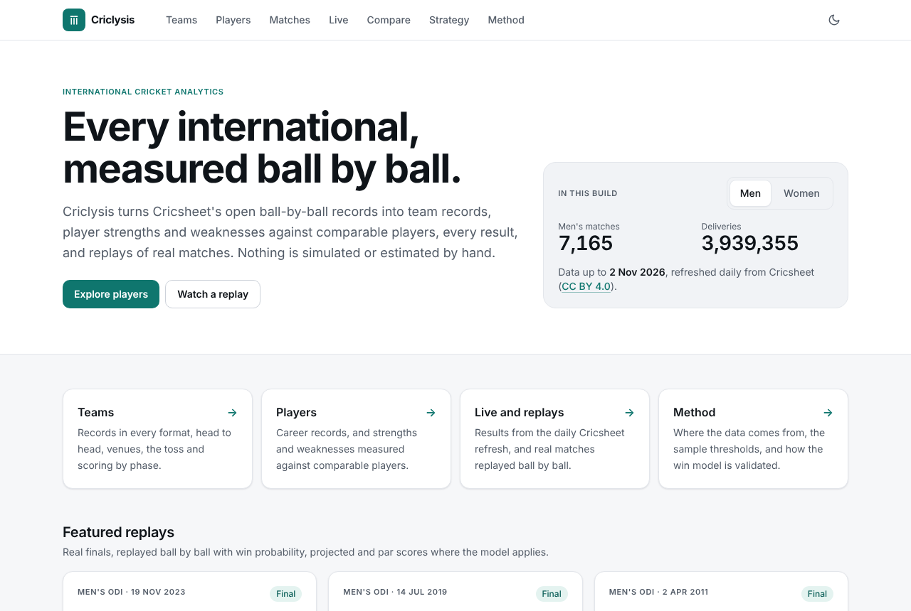
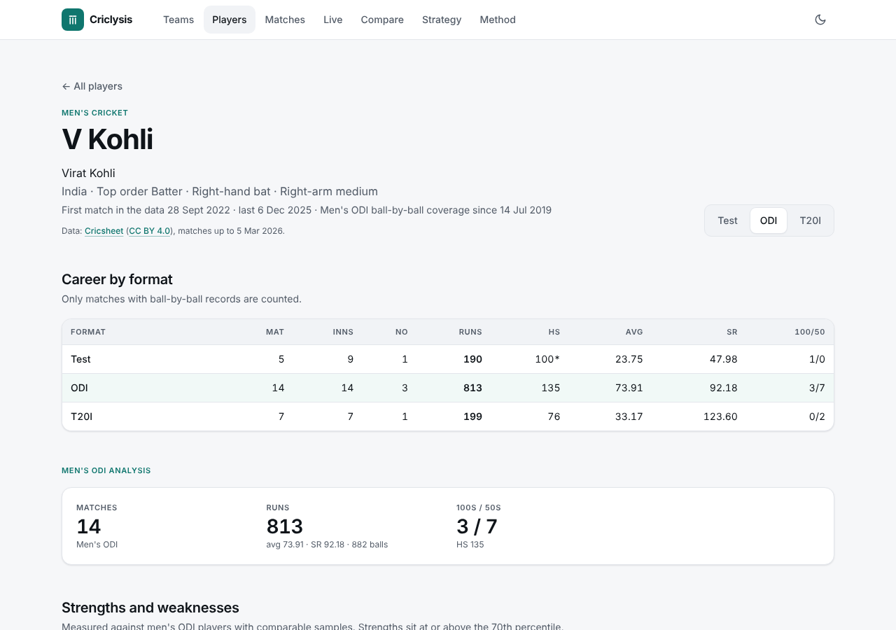
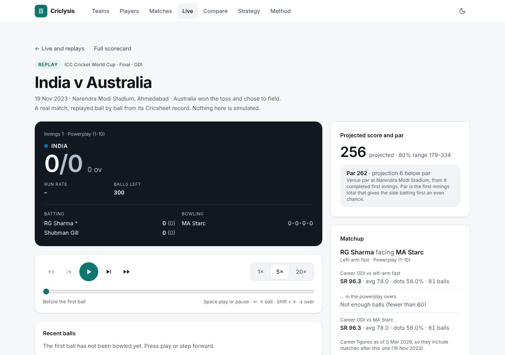
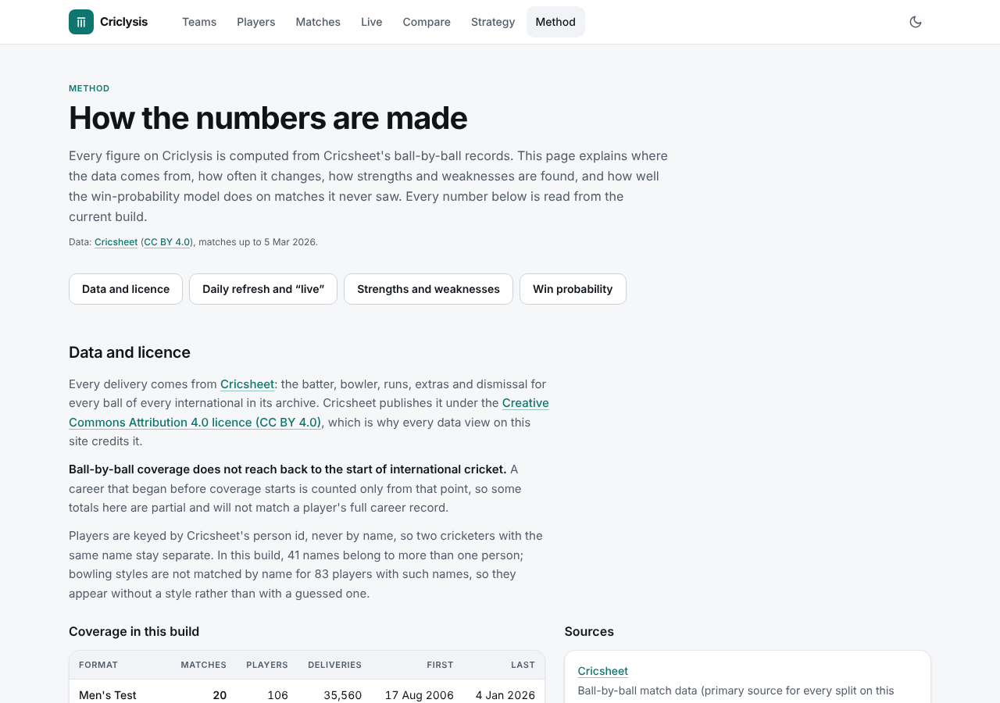
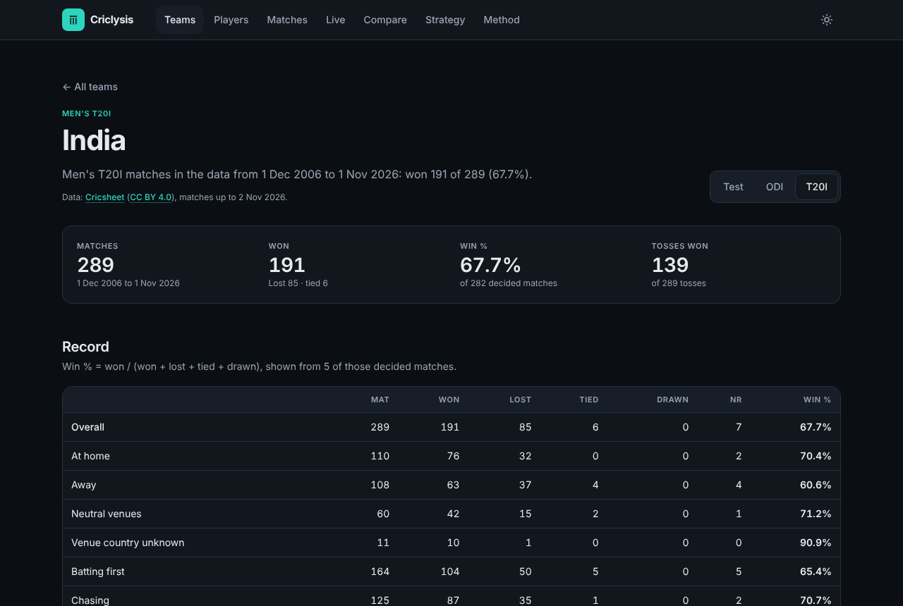
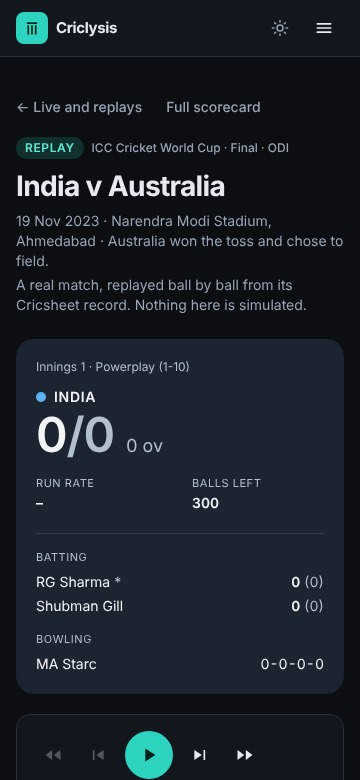
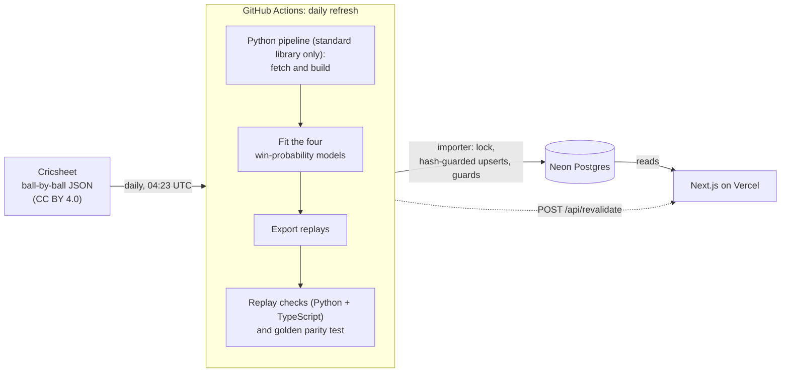

# Criclysis

**Cricket analytics for every men's and women's international team, built only
from open ball-by-ball data.**

Criclysis turns [Cricsheet](https://cricsheet.org)'s public ball-by-ball
records into team records, player strengths and weaknesses measured against
comparable players, and replays of real matches with a validated
win-probability model. A GitHub Action rebuilds everything from Cricsheet
every day, so new internationals appear within about a day. "Live" here means
that daily refresh plus a replay engine; there is no live-score API, no API
key and no paid service.

<!-- TODO: live link -->

As of the 9 Nov 2026 build (refreshed daily): **10,009 matches**, **5,329
player profiles**, **201 teams** and **382 venues**, with data through
2 Nov 2026.

## Screenshots

> These come from a local production build on the **110-match development
> fixture** (`fixtures/data-out`), not the full dataset, so the numbers in them
> differ from the live site. For example, Virat Kohli shows 14 ODIs here.

| | |
|---|---|
|  |  |
| Home | Player profile |
|  |  |
| Replay with projection, par and matchup | Method page |
|  |  |
| Team page, dark mode | Replay on a phone, dark mode |

## What it does

### 1. Match and team analysis for every international side

Men's and women's Tests, ODIs and T20Is, including associate nations.

- **Coverage** (9 Nov 2026 build): 899 men's Tests, 2,617 men's ODIs, 3,649
  men's T20Is, 24 women's Tests, 620 women's ODIs and 2,200 women's T20Is.
  That is 4,810,633 deliveries in total. The full table is in
  [docs/DATA_SOURCES.md](docs/DATA_SOURCES.md#coverage-read-this-before-trusting-a-career-total).
- **Team pages:** results overall, at home, away and at neutral venues;
  batting first and chasing; the toss; scoring by phase; venues; and
  head-to-head pages for any two teams.
- Every match has a scorecard page.

### 2. Player analysis

5,329 players have a profile: everyone who has faced 60 balls, or bowled 240
balls or taken 5 wickets, in at least one format.

- **Strengths and weaknesses** are judged against a cohort of comparable
  players in the same format and gender: batters with at least 600 balls
  faced, or bowlers with at least 900 balls bowled.
- A split becomes a claim only if it has at least 150 balls (240 for
  bowling) and at least 8 comparable players, differs from the player's own
  overall figure by at least 4%, and ranks at or above the 70th percentile of
  the cohort (a strength) or at or below the 30th (a weakness). Small samples
  are first shrunk toward the player's own overall figure.
- **Matchups** by bowling type (ten types, from right-arm fast to left-arm
  wrist spin), by pace or spin and by phase of the innings; for bowlers, also
  by the batter's hand. Bowling styles are known for 5,650 players.
- **Form:** the last 10 innings with the bat and with the ball, next to the
  career figures.
- **Compare** puts two players side by side; **Strategy** builds a scouting
  plan from a player's claims.

### 3. "Live" without an API

- **Daily refresh.** At 04:23 UTC a GitHub Action downloads Cricsheet's
  archives, rebuilds the dataset, checks it and imports it. If Cricsheet's
  files haven't changed, the build and import are skipped.
- **Replay engine.** Every one of the 10,009 matches can be replayed ball by
  ball (21.8 MB of gzipped replays; 30 featured, such as World Cup finals).
  At each ball the replay shows:
  - **win probability** for ODIs and T20Is, from four models (men's and
    women's ODI and T20I) validated on matches from 2023 on, which they never
    saw;
  - **projected score** with an 80% range, and **par**, adjusted for the
    ground;
  - **matchup cards:** the batter's record against the current bowler's type
    and against that bowler.

How the models work, and how well: [docs/WINPROB.md](docs/WINPROB.md).

### 4. A clean, accessible, responsive UI

- One design system: teal accents on neutral surfaces.
- Dark mode follows the system setting, with a toggle that doesn't flash on
  load.
- A Men/Women switch kept in the URL (`?gender=women`), so a filtered view can
  be shared.
- Pages work from 360 pixels wide.
- An automated axe check against WCAG 2.1 AA (the web accessibility standard)
  found no violations.
- Every chart has a "View as table" fallback. Every page has loading, empty
  and error states, and unknown ids return a real HTTP 404.
- A **Method page** (`/method`) explains the data, the thresholds and each
  win model's validation, read from the database rather than typed in.

## How it works



1. **Pipeline** (`pipeline/`, Python, standard library only). Downloads
   Cricsheet's archives, aggregates every ball into per-player, per-team and
   per-venue records, finds strengths and weaknesses, fits the win-probability
   models and exports a replay file for every match.
2. **Checks.** Before anything is imported, every replay is checked against
   the rest of the build in Python and in TypeScript, and the TypeScript
   win-probability port is checked against Python.
3. **Import** (`web/scripts/import/`). Loads the build into Postgres in small
   transactions, rewriting only rows whose content changed, behind guards
   that refuse a build that would silently delete data.
4. **Web** (`web/`). Reads the database, caches pages for a day, and drops
   the cache when the refresh calls `/api/revalidate` after an import.

The design and its trade-offs are in
[docs/ARCHITECTURE.md](docs/ARCHITECTURE.md).

## Stack

| Layer | Tools (versions from `web/package.json`) |
|---|---|
| Pipeline | Python 3.11+ (CI uses 3.12), standard library only |
| Web app | Next.js 16.4.3 (App Router), React 19.2.6, TypeScript 5.9.3 |
| Styling and charts | Tailwind CSS 4.1.17, Recharts 3.10 |
| Database | PostgreSQL (Neon free tier in production, 16 in CI), Drizzle ORM 0.45.2, drizzle-kit 0.31.10, node-postgres 8.20.0 |
| Tests and lint | Vitest 3.2, ESLint 9.39.4, Python `unittest` |
| Hosting and CI | Vercel (web), Neon (database), GitHub Actions (CI and daily refresh), Node.js 22 |

## Validation

As of the 9 Nov 2026 build (GitHub Actions run 42620030605; refreshed daily):

| Check | Result |
|---|---|
| Men's ODI win model, chase Brier on 432 unseen matches (constant forecast) | 0.1354 (0.2504) |
| Women's ODI win model, 216 unseen matches | 0.1114 (0.2537) |
| Men's T20I win model, 1,863 unseen matches | 0.1070 (0.2500) |
| Women's T20I win model, 1,317 unseen matches | 0.1041 (0.2481) |
| Replays checked against the build (Python) | 10,009 of 10,009 agree: 21,432 innings, 116,443 bowling innings |
| Replay engine checked against the build (TypeScript) | 10,009 of 10,009 agree: 109,118 bowling innings |
| TypeScript win-probability port vs Python | largest difference 2.2e-16 across all four models (tolerance 1e-9) |

The Brier score is the mean squared error of a probability; lower is better.
The chase models remove 46% to 58% of the constant forecast's error. Details,
first-innings scores and calibration: [docs/WINPROB.md](docs/WINPROB.md).

## How it stays honest

- **No fabricated numbers.** Every figure comes from Cricsheet's records. The
  importer refuses any build not marked as real Cricsheet output. A bowler
  whose style can't be matched safely gets no style, not a guess.
- **Sample gates.** Splits are hidden below 60 balls (90 for bowling).
  Strengths and weaknesses need 150 balls (240 for bowling) and at least 8
  comparable players. Team win percentages are hidden below 5 decided matches
  and venue averages below 3 innings. Claims show their sample size.
- **Coverage is stated.** Ball-by-ball data starts in 2001 for men's Tests and
  later for other formats, so older careers are partial. Every profile says
  which period it covers.
- **Players are keyed by Cricsheet's person id,** never by name, so two
  players who share a name stay separate.
- **Replay checks.** Every daily build checks every replay's innings totals,
  wickets, extras and bowler figures against the statistics, in Python and in
  TypeScript, before importing.
- **Parity test.** The win-probability code runs in Python (fitting) and
  TypeScript (the site). A golden test holds the two to within 1e-9 on every
  build.
- **Out-of-sample validation.** The win models are scored on matches they
  never saw, and the recency weighting is chosen without looking at those
  matches.

Known limitations, including four Cricsheet person ids that each belong to
two different people, are in
[docs/DATA_SOURCES.md](docs/DATA_SOURCES.md#known-limitations) and
[docs/WINPROB.md](docs/WINPROB.md#known-limitations).

## Quick start

This runs the site locally on the committed 110-match fixture. You need
Python 3.11+, Node.js 22 and PostgreSQL 16. The full setup, including a
one-line Docker database, is in
[docs/OPERATIONS.md](docs/OPERATIONS.md#6-local-development).

```bash
git clone https://github.com/atharva9806/criclysis.git
cd criclysis/web
npm ci
cp .env.example .env        # Windows: copy .env.example .env; then set DATABASE_URL
npm run db:migrate
npm run import -- --data ../fixtures/data-out
npm run build
npm run start               # http://localhost:3000
```

The pipeline itself needs no installation: `python -m pipeline --help` from
the repository root lists its commands. Building the full dataset needs
access to cricsheet.org.

## Project structure

| Path | What |
|---|---|
| `pipeline/` | Python pipeline: download, aggregate, analyse, fit models, export and verify replays |
| `tests/` | Python unit tests |
| `web/` | Next.js app: pages and API routes in `src/app/`, data layer, win-probability port and replay engine in `src/lib/` |
| `web/scripts/import/` | The importer from a build into Postgres, and the fingerprint check |
| `web/drizzle/` | Database migrations |
| `fixtures/data-out/` | The 110-match development fixture used locally and in CI |
| `fixtures/data-out-v1/` | An older-format men's sample, kept for importer tests |
| `data/` | Bowling-style reference files; generated output goes to `data/out/` (not committed) |
| `scripts/ci/` | Refresh plan, smoke test, log redaction and build-size summary |
| `docs/` | [Architecture](docs/ARCHITECTURE.md), [data sources](docs/DATA_SOURCES.md), [win probability](docs/WINPROB.md), [operations](docs/OPERATIONS.md) |
| `.github/workflows/` | `ci.yml` and the daily `refresh.yml` |

## Testing and CI

Every pull request and push to `main` runs four jobs (`.github/workflows/ci.yml`):

1. **Pipeline tests:** `python -m unittest discover -s tests -p "test_*.py"`.
2. **CI scripts:** shellcheck, plus tests of the refresh plan and the smoke
   script.
3. **Web:** `npm run typecheck`, `npm run lint`, `npm test` (Vitest) and
   `npm run build`.
4. **End to end:** starts PostgreSQL 16, migrates an empty database, imports
   the fixture, imports it again and asserts nothing changed, builds and
   starts the production server, requests every page and API route, and
   checks that `/api/revalidate` rejects a wrong secret.

The daily refresh (`.github/workflows/refresh.yml`) adds the checks that need
the full corpus: the replay checks and the golden test. How it runs, and what
to do when it fails: [docs/OPERATIONS.md](docs/OPERATIONS.md).

## Data credit

Ball-by-ball data is from [Cricsheet](https://cricsheet.org), licensed under
[CC BY 4.0](https://creativecommons.org/licenses/by/4.0/). The site credits
Cricsheet on every data view. Bowling styles and batting hands come from a
separate player-metadata file that is not Cricsheet data and is not open
data; its provenance and caveats are in
[docs/DATA_SOURCES.md](docs/DATA_SOURCES.md#2-bowling-style-and-batting-hand).

## Licence

The source code is MIT-licensed; see [LICENSE](LICENSE). The licence covers
the code only. Cricsheet's data stays under CC BY 4.0, and any deployment must
credit Cricsheet.
